<picture>
  <source media="(prefers-color-scheme: dark)" srcset="assets/hero-dark.svg"/>
  
</picture>

Collective Adaptive Systems · Aggregate Computing · Multi-Agent RL · LLMs for Software Engineering

 

## 🤖 About Me

I'm fascinated by all things related to [emergence](https://en.wikipedia.org/wiki/Emergence) and [complexity](https://en.wikipedia.org/wiki/Complex_system). My research focuses on engineering [collective adaptive systems](https://www.unige.ch/cui/cas/), and in particular on:

- 🌐 **Aggregate computing** — programming large-scale distributed systems as a whole ([intro](https://ieeexplore.ieee.org/document/7274429))
- 🧠 **Multi-agent cooperative reinforcement learning** — learning collective behaviours instead of hand-coding them
- 🤝 **Foundation models for software engineering** — from requirement management to development

Beyond research, I'm a huge **Scala** enthusiast!

  
  
  
  

## 🔬 Featured Projects

<table>
  <tr>
    <td width="50%" valign="top">
      <h3>🪐 <a href="https://github.com/scafi/scafi">ScaFi</a></h3>
      
      
Core contributor. A Scala framework for aggregate programming, with tools like <a href="https://ieeexplore.ieee.org/document/10771268">ScaFi Web</a> and <a href="https://github.com/cric96/ScaFi-Blocks">ScaFi Blocks</a>.

      📄 <a href="https://doi.org/10.1016/j.softx.2022.101248">SoftwareX '22</a>
    </td>
    <td width="50%" valign="top">
      <h3>🐍 <a href="https://github.com/phyelds/phyelds">Phyelds</a></h3>
      
      
Aggregate computing, reimagined for Python: field-based coordination for adaptive, distributed systems.

      📄 <a href="https://doi.org/10.1007/978-3-032-28358-0_9">COORDINATION '26</a>
    </td>
  </tr>
  <tr>
    <td width="50%" valign="top">
      <h3>🧠 <a href="https://f14-bertolotti.github.io/shacpp/">SHAC++</a></h3>
      
      
A novel algorithm for multi-agent systems based on differentiable reinforcement learning.

      📄 <a href="https://doi.org/10.3233/FAIA251138">ECAI '25</a>
    </td>
    <td width="50%" valign="top">
      <h3>🚁 <a href="https://github.com/Project-Emerge">Project Emerge</a></h3>
      
      
Hands-on demo with real autonomous drones, showcased at the European Researchers' Night.

      📄 <a href="https://doi.org/10.1016/j.scico.2026.103559">Science of Computer Programming '26</a>
    </td>
  </tr>
</table>

## 📄 Selected Publications

**🌐 Aggregate Computing & Swarm Programming**
- <kbd>ACM TOSEM '25</kbd> [Software Engineering for Collective Cyber-Physical Ecosystems](https://doi.org/10.1145/3712004)
- <kbd>LMCS '25</kbd> [MacroSwarm: A Field-based Compositional Framework for Swarm Programming](https://doi.org/10.46298/lmcs-21(3:13)2025)
- <kbd>SoftwareX '22</kbd> [ScaFi: A Scala DSL and Toolkit for Aggregate Programming](https://doi.org/10.1016/j.softx.2022.101248)

**🧠 Learning in Collective Systems**
- <kbd>ECAI '25</kbd> [SHAC++: A Neural Network to Rule All Differentiable Simulators](https://doi.org/10.3233/FAIA251138)
- <kbd>LMCS '26</kbd> [FBFL: A Field-Based Coordination Approach for Data Heterogeneity in Federated Learning](https://doi.org/10.46298/lmcs-22(1:19)2026)
- <kbd>FGCS '26</kbd> [Heterogeneous GNN for Collective-Task Offloading in Cloud-Edge via Deep Q-Learning](https://doi.org/10.1016/j.future.2026.108539)

**🤖 LLMs, Agents & Software Engineering**
- <kbd>ACM TIoT '25</kbd> [A Language-based Approach to Macroprogramming for IoT Systems through Large Language Models](https://doi.org/10.1145/3758326)
- <kbd>JSS '26</kbd> [Java Academic Benchmark: Exam-based Evaluation of LLMs on Object-Oriented Programming](https://doi.org/10.1016/j.jss.2026.113033)
- <kbd>ECAI '25</kbd> [Exploiting GenAI for Plan Generation in BDI Agents](https://doi.org/10.3233/FAIA251223)

➡️ Full list on [Google Scholar](https://scholar.google.com/citations?user=YY_KZzoAAAAJ&view_op=list_works&sortby=pubdate) · [DBLP](https://dblp.org/pid/294/4314.html)

## 🎓 Teaching

Adjunct professor at the University of Bologna:

| Course | Degree |
| :-- | :-- |
| **Advanced Software Modelling and Design** (Module 2) | Master's in Computer Science and Engineering |
| **Paradigmi di Programmazione e Sviluppo** (Module 2) | Master's in Computer Science and Engineering |
| **Progettazione e Sviluppo del Software** (Module 2) | Bachelor's in Computer Systems Technologies |

📌 Latest course updates on my [official university page](https://www.unibo.it/sitoweb/gianluca.aguzzi).

## 📊 GitHub Metrics

  <picture>
    <source media="(prefers-color-scheme: dark)" srcset="https://github-profile-summary-cards.vercel.app/api/cards/profile-details?username=cric96&theme=github_dark"/>
    
  </picture>
  <picture>
    <source media="(prefers-color-scheme: dark)" srcset="https://github-profile-summary-cards.vercel.app/api/cards/repos-per-language?username=cric96&theme=github_dark"/>
    
  </picture>
    
  
   
  

